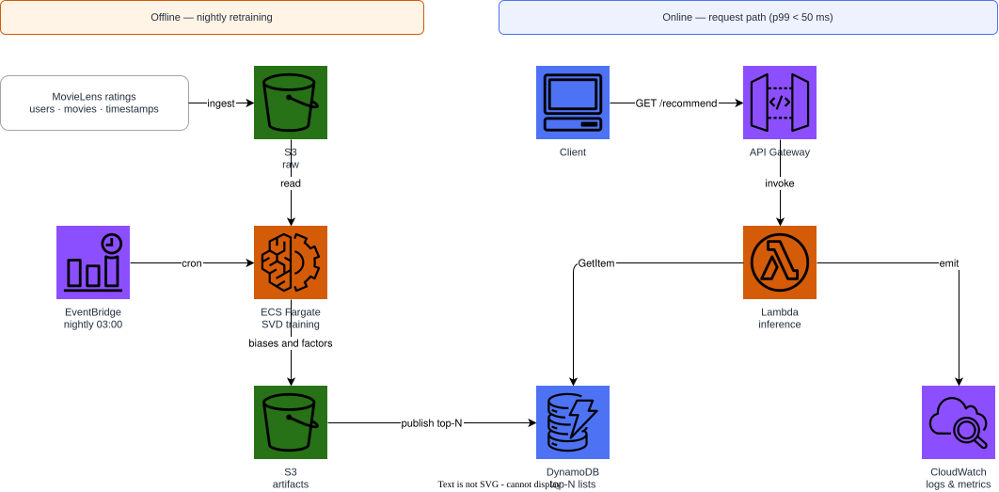
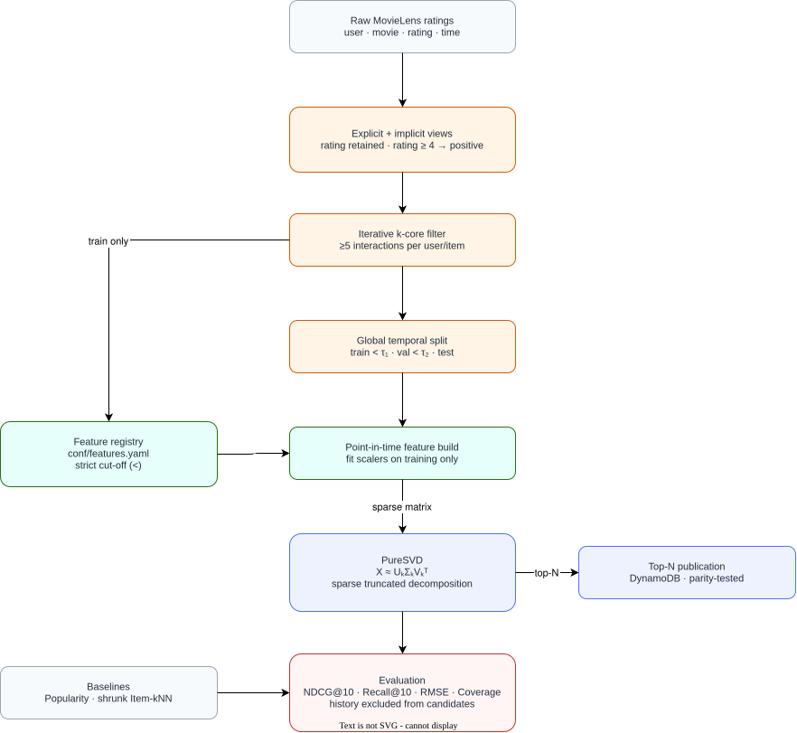

# MovieLens Classical PureSVD Ranking

Classical PureSVD matrix factorization for MovieLens top-$N$
recommendation, benchmarked against tuned item-neighbourhood and popularity
baselines under a **global temporal split**. The implementation uses NumPy
only: no neural networks, deep-learning framework, transformer, or LLM.

MovieLens ships real event timestamps, so this project does what the anime
BPR project could not: split on wall-clock time rather than on a per-user
sequence proxy. Everything before a cut-off date is training data; everything
after is evaluation data. That is strictly harder than leave-last-one-out and
much closer to how a deployed model is actually judged.

---

## Headline result

See [Evaluation](#evaluation). SVD is judged against ItemKNN rather than against
an intentionally weak baseline. Both global temporal and leave-last-one-out
numbers are reported because protocol choice can move the result more than a
small algorithm change.

---

## Quick start

```bash
python -m venv .venv && source .venv/bin/activate
pip install -e ".[dev]"

# Fetch MovieLens, or generate a synthetic fixture with the same schema
python scripts/download_data.py --synthetic

# Build the point-in-time feature tables
python scripts/build_features.py

# Train, evaluate, recommend
python -m recommender.cli train
python -m recommender.cli evaluate
python -m recommender.cli recommend --user-id 1 --k 10
```

The real dataset:

```bash
python scripts/download_data.py --movielens ml-latest-small
```

---

## Why a temporal split

Leave-last-one-out holds out each user's final interaction. It is convenient,
but it leaks: training data contains events that occurred *after* the held-out
events of other users. A model can therefore exploit future global trends —
which film became popular, which did not — that would not have existed at
prediction time.

A global temporal split removes that. We pick a cut-off $\tau$ and train only
on $\{(u,i,t) : t < \tau\}$.

The cost is honesty about difficulty: metrics drop, cold users appear in the
evaluation set, and the popularity prior goes stale. Those are properties of
the problem, not of the protocol. Both protocols are implemented and both are
reported, so the gap between them is visible rather than hidden.

---

## Architecture

### AWS deployment



### Recommendation flow



Both diagrams are editable: [`docs/aws-architecture.drawio`](docs/aws-architecture.drawio)
and [`docs/recommendation-architecture.drawio`](docs/recommendation-architecture.drawio).

Regenerate them with:

```bash
python -m venv .diagram-venv && .diagram-venv/bin/pip install drawpyo
.diagram-venv/bin/python scripts/generate_diagrams.py
docker run --rm -v "$PWD/docs":/data -w /data rlespinasse/drawio-export \
  -f svg -o . --output-mode relative --remove-page-suffix .
# The exporter writes as root; reclaim ownership before committing.
docker run --rm -v "$PWD/docs":/data alpine chown -R "$(id -u):$(id -g)" /data
```

---

## Models

| Model | Scorer | Notes |
|---|---|---|
| `Popularity` | global count | Non-personalised floor |
| `ItemKNN` | cosine item-item | The baseline most notebooks stop at |
| `PureSVD` | $X\approx U_k\Sigma_kV_k^\top$ | Classical truncated matrix factorization |
| `ItemKNN` | shrunk cosine co-occurrence | Strong neighbourhood baseline |
| `Popularity` | global interaction count | Non-personalised floor |
| `Random` | deterministic random ordering | Sanity-check floor |

PureSVD decomposes the binary user-item interaction matrix with sparse linear
algebra. Top-$N$ ranking uses the low-rank reconstruction after filtering the
user's training history.

---

## Feature engineering

Features are declared in [`conf/features.yaml`](conf/features.yaml) and
implemented in `src/recommender/features/`. Every aggregate is computed
**point-in-time** against a real timestamp: only interactions strictly before
the prediction time contribute.

### Leakage controls

`tests/test_features_leakage.py` asserts that:

1. Injecting an interaction **after** the cut-off does not change any feature.
2. Popularity and encoding tables are fitted on the training partition only.
3. Shuffling labels collapses ranking quality to the random baseline.

---

## Evaluation

Global temporal split with a configurable cut-off quantile, plus
leave-last-one-out for comparability with published notebooks. Candidates are
the full catalogue minus each user's training history.

Results are generated by `python scripts/export_results_table.py`, which
writes both `paper/tables/results.tex` and the Markdown block below, so the
README, the paper, and the code cannot drift apart.

<!-- RESULTS:START -->
| Model | NDCG@10 | Recall@10 | MRR@10 | Coverage |
|---|---:|---:|---:|---:|
| PureSVD | 0.0848 | 0.1010 | 0.1546 | 0.2838 |
| ItemKNN | 0.0961 | 0.1209 | 0.1613 | 0.5292 |
| Popularity | 0.0863 | 0.0867 | 0.1841 | 0.0284 |
<!-- RESULTS:END -->

---

## Infrastructure

```bash
docker compose up -d
terraform -chdir=terraform init
terraform -chdir=terraform validate
terraform -chdir=terraform apply -auto-approve
terraform -chdir=terraform destroy -auto-approve
docker compose down
```

Terraform targets the local Floci AWS emulator at `http://localhost:4566` with
dummy credentials, so the default path costs nothing and needs no AWS account.
Real-AWS deployment is documented in [`terraform/README.md`](terraform/README.md).

---

## Paper

Methodology, equations, and results are in [`paper/main.pdf`](paper/main.pdf).

```bash
make -C paper tables   # regenerate tables from the code
make -C paper docker   # build the PDF in a container
```

---

## License and data

Code is MIT licensed. MovieLens is distributed by GroupLens under its own
terms and is **not** redistributed here; `scripts/download_data.py` fetches it
on demand or generates a synthetic fixture with the same schema.
